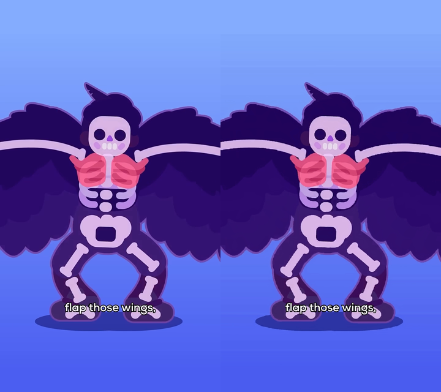
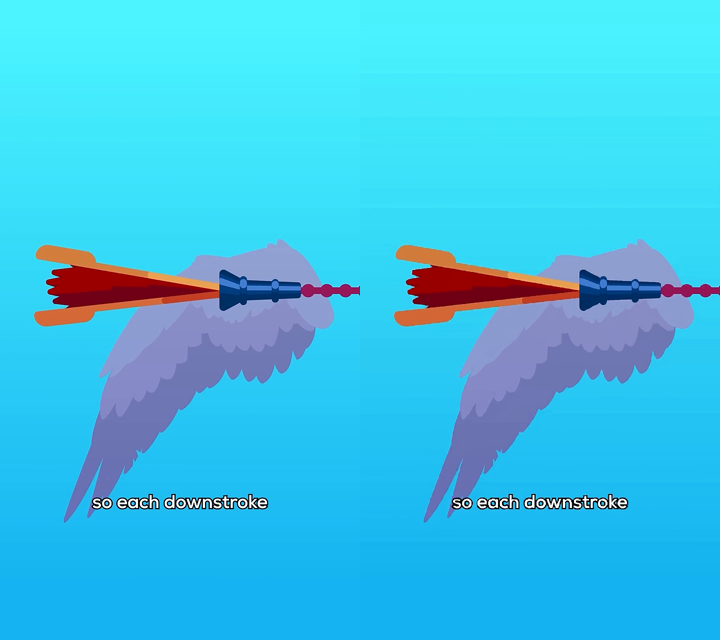
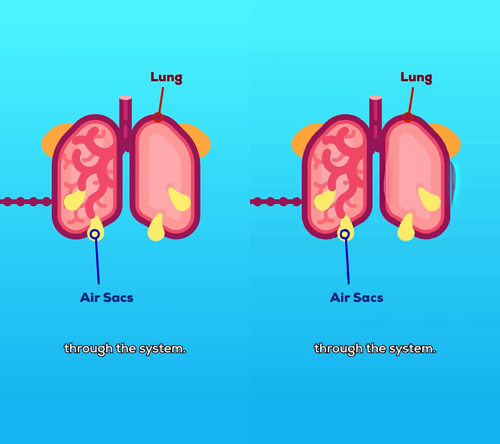
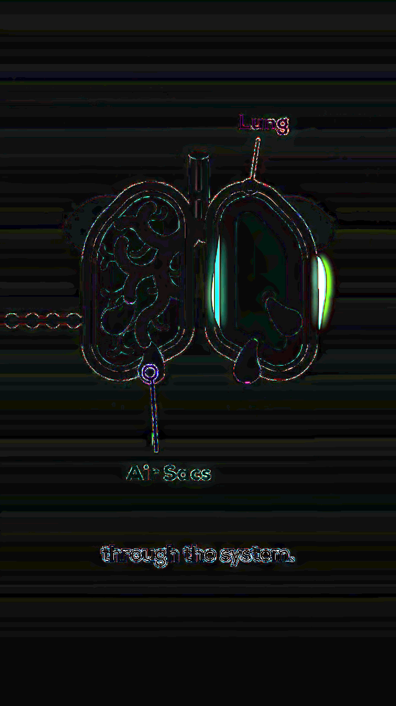
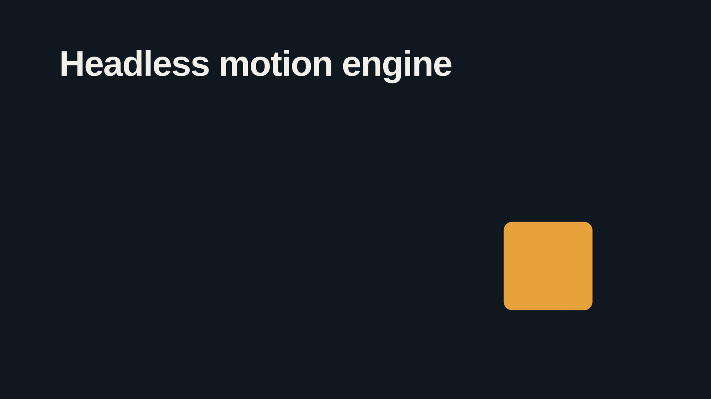

<p align="center">
  
</p>

# Headless Motion


Motion graphics from JSON scenes. No timeline UI, no manual keyframes.

Headless Motion is a toolkit that lets an AI agent design, build, and check motion graphics entirely in code, with no screen, player, or timeline, so the agent creates and measures animation by numbers instead of watching it.

An agent writes a scene, the engine renders the video, and a checker scores every frame against a reference. The goal is animation on par with top YouTube animation channels, produced end to end without a human opening an editor.

## Proof

The first proof the toolkit works is a 1-to-1 clone of the first 30 seconds of a Kurzgesagt Short. Cloning was the first proof, not the whole tool. The toolkit itself is the general capability: an agent doing motion design headlessly.

<video src="docs/proof/side-by-side-30s.mp4" width="720" controls></video>

Above: the side-by-side video, reference on the left, clone on the right, 30 seconds, 24 fps. Source: Kurzgesagt "Could Humans Evolve Flight?", first 30 seconds, 720p, 60 fps, vertical. Clone: 720x1280, 24 fps, 720 frames, 30.0 seconds.

An independent judge re-verified every number with its own scripts. The verdict is PASS WITH GAPS.

| Gate | Mean SSIM | Mean PSNR | Min SSIM | LPIPS | Frames below 0.90 |
| --- | --- | --- | --- | --- | --- |
| Gate 1, first 10 s, 240 frames | 0.9926 | 36.21 dB | 0.9887 | 0.0134 | 0 |
| Gate 2, full 30 s, 720 frames | 0.9938 | 36.16 dB | 0.9887 | 0.0106 | 0 |

Gate 2 had 0 frames below 0.90 and 0 frames below 0.85. It also measured flat colour max 1.71 Delta E (bar 3) and text shift max 0.5 px (bar 2). The human gate passed on November 9, 2026: the side-by-side was watched at full speed and 0.25x with no visible mismatch. Cost was $0, Muse Spark only.

Proven on one style: flat 2D vector animation. 3D and grain are untested.

### Evidence stills

Side-by-side stills, reference on the left, clone on the right.






### Difference maps

Absolute difference, amplified 8x. Bright pixels are where the clone differs from the reference. The maps are nearly black, which is the point.




### Who did what

Three actors, not two. We built the tools. Muse Spark was the operator that uses them. Headless Motion is the instruments, built specifically so a model can operate them. The model decides. The tools execute. We built the tools so the model could do the job at all.

## Why headless

After Effects is built for a human hand on a timeline. An agent cannot scrub, drag keyframes, or judge a frame by eye. Headless Motion turns the whole job into files an agent can write and check: a scene is JSON, a render is one command, and the verdict is numbers, not an opinion.

## How it works


## The interface is a language

Headless Motion has no timeline to drag. Its interface is three things an agent can read and write.

1. A scene file. One JSON file, schema `hme.scene/1.0`, holds the whole video: nodes, palette, fonts, and the timeline.
2. A command. One line renders it: `node src/renderer/cli.mjs render <scene> --profile final --out <dir>`.
3. A verdict. One check scores every frame against the reference and says pass or fail, with the numbers behind it.

An agent drives it through five prompt files in `prompts/`, which teach it the scene format, the renderer, the map system, the chart and text module, and the frame checker. Nothing in the tool needs a human hand, a mouse, or an eye. That is why an agent can run it end to end, and why the proof is a number, not a feeling.

If you can write the scene, you can make the video. If you can read the check, you can tell if it worked.

## Tools

Each tool is a file an agent can call, not a screen to open. Status is what the last independent check said.

### Core tools

| Tool | File | What it does | Status |
| --- | --- | --- | --- |
| Reference teardown | `src/reference/teardown.py` | Measures a reference video into a profile: palette with source frame and coords, geometry as ratios, shots, cuts, events, per-colour trajectories, VTracer traces per keyframe | Pass, judge confirmed |
| Easing and timing picker | `src/scene/pick-ease.mjs` | Ranks easing curves and springs by measured error against a reference trajectory, and ranks flow-guided warp intervals per shot | Pass, judge confirmed |
| Defect taxonomy and log | `src/checker/defects.json`, `src/checker/defects.py` | Maps every checker failure code to a defect class, likely cause, and suggested fix; logs one row per failure and writes a summary | Pass, judge confirmed |
| Banned list | `banned.json` | Patterns that must never ship again, linted before rendering; grows from confirmed defects | Pass, judge confirmed |
| Frame checker | `src/checker/` | Scores every frame against a reference: SSIM, PSNR, LPIPS, flat colour, motion, text shift, layer layout | In use, Gate 3 LPIPS still being measured |
| Renderer | `src/renderer/` | Headless Chromium capture plus ffmpeg encode, deterministic, 1920x1080 at 24 fps | In use |
| Map module | `src/map/` | Draws real Natural Earth geography with a fixed visual system | In use |
| Chart and text module | `src/scene/` | Bars, lines, and kinetic type | In use |
| CLI | `src/cli/hme.mjs` | One command surface for render, check, compare, and player pass | In use |
| Player pass | `run-player-pass.py` | Screenshots our own video the same way the reference is screenshotted, so the check compares like with like | In use |

The three new tools in this table, teardown, picker, and taxonomy with banned list, were built in November 2026 to fix what the engine could not do before: it could not see a reference style, it could not pick an ease by numbers, and it forgot every failure it found.

### Measurement tools

One `hme` command measures one thing, and every measurement returns the same shape: a verdict, the numbers, a correction in scene terms, the next most useful command, and its limits. Run them from the repo root as `node src/cli/hme.mjs <command>`. An agent reads the correction and applies it; it does not guess from a score.

| Tool | Command | What it measures | Status |
| --- | --- | --- | --- |
| Compare | `hme compare` | Full frame scores: SSIM, PSNR, LPIPS, flat colour | In use |
| Diagnose | `hme diagnose` | Names the kind of error and the fix, from a frame pair | In use |
| Trace | `hme trace` | Profiles a video: palette, labels, trajectories, cuts | In use |
| Control | `hme control` | The ceiling a perfect clone can reach, by re-encoding our own video | In use |
| Extract | `hme extract` | Cuts a pixel region out of a reference frame, such as the rifle | In use |
| Fonts | `hme fonts` | Ranks free fonts by glyph shape against a reference label | In use |
| Zoom velocity | `hme zoom-velocity` | Zoom speed curve per second, and flags knots where the curve bends | Done, judge confirmed |
| Contour | `hme contour` | Shape difference between two outlines, Hausdorff and Chamfer distance | Done, judge confirmed |
| Blur and grain | `hme blur-grain` | Blur and grain ratios, reference vs ours | Built, judge not yet run |
| Vignette | `hme vignette` | Corner darkness, matched mean ratio | Done, judge confirmed |
| Colour and halo | `hme colour` | Whole-frame colour histograms and halo falloff around a centre | Done, judge confirmed |
| Layering | `hme layering` | Z-order and pixel counts per layer: badge, text, halo, dot | Done, judge confirmed |
| Type | `hme type` | Typography: font match, glyph shape, spacing, weight | Judge confirmed |
| Timing | `hme timing` | Timing offset per object, median and warp table, not one global shift | Built, judge not yet done |

Two facts an agent should know before trusting a number. First, the ceiling: a perfect clone scores about 0.96 SSIM, not 1.00, because YouTube compression alone costs 0.03 to 0.07. The control tool measures that ceiling for the exact pair. Second, the timing offset is not constant: on the Seg4 map the badge is 0.46 to 1.08 seconds early depending on the second, median 0.71. A single delay leaves about 20 px of error; the warp table leaves about 2 px. The timing tool reports both.

### Authoring tools

These close the gaps the measurement tools found in the Kurzgesagt "Alcohol is AMAZING" first 5 seconds. Each one is a Handover run with its own predicate, verifier, and judge. Status is from each run's own status file, November 9, 2026.

| Tool | What it adds | Status |
| --- | --- | --- |
| Character rig | A skeleton with named parts and pivots, so eyes open, eyebrows raise, and arms lift by keyframing joints instead of hand-drawing every shape | 70%, proof render done |
| Illustration tracing | Converts reference art into vector paths with VTracer, Potrace fallback, and a pixel cutout fallback for subjects that will not trace | 20%, monster traces at SSIM 0.90, skulls pass as pixel cutout at 0.99 |
| Gradients and glow | Gradient fills, glow as a crisp shape plus halo, and soft blurred edges, for clouds, bokeh, and foam shading | 50%, proof passes within the colour bar |
| Particle system | Deterministic particles from a seed, so the same scene renders byte-identical: foam bubbles, sparkles, drifting clouds | Built, final verification pending |
| Automated fixing | Reads a measurement report and applies the correction to the scene, writing a new versioned file, never editing in place | 60%, five fixer functions done |

A note on scope: the rig proves the mechanism with simple shapes. A faithful character still needs traced shapes for hair, face shading, and clothing, which is the tracing run's job. The two runs compose; neither replaces the other.

## What it renders

These are actual frames from real renders, not mockups.

 

Left: map-sample, final profile, 5 seconds in. Right: scene-min, final profile, 5 seconds in.

## Quickstart

Requirements: Node 20 or newer, ffmpeg, and Chromium (installed through Playwright).

```bash
npm install
node src/renderer/cli.mjs render tests/fixtures/scene-min.json --profile draft --out out/scene-min
```

That renders a 10 second, 1920x1080, 24 fps clip. Profiles:

| Profile | Size | Supersample | Preset | CRF | Use |
| --- | --- | --- | --- | --- | --- |
| previs | 854x480 | 1 | veryfast | 28 | Fast look, iterate |
| draft | 1920x1080 | 1 | fast | 20 | Check timing and layout |
| final | 1920x1080 | 1.5 | medium | 14 | Deliver |
| final-max | 1920x1080 | 2 | slow | 14 | Best quality |

Render only part of a scene with `--frames 0:120`. Override any scene value without editing the file with repeatable `--set nodes.title.props.text="Hello"`.

## Scene format

A scene is one JSON file, schema `hme.scene/1.0`. Nodes are text, shapes, maps, or charts. A timeline moves node properties between keyframes with named easings. An example (shortened):

```json
{
  "schema": "hme.scene/1.0",
  "meta": { "id": "hello", "fps": 24, "width": 1920, "height": 1080, "duration": 240, "seed": 1337 },
  "fonts": [{ "family": "Montserrat", "weight": 700, "src": "fonts/Montserrat-Bold.ttf" }],
  "palette": { "ground": "#101820", "ink": "#f4f1ea", "accent": { "color": "#e8a33d" } },
  "nodes": [
    { "id": "title", "type": "text", "z": 2,
      "box": { "x": 160, "y": 120, "w": 1600, "h": 160 },
      "props": { "text": "Headless Motion",
        "font": { "family": "Montserrat", "weight": 700, "size": 96 },
        "color": "ink", "align": "left" } },
    { "id": "bar", "type": "shape", "z": 1,
      "box": { "x": 160, "y": 600, "w": 240, "h": 240 },
      "props": { "kind": "rect", "fill": "accent", "radius": 24 } }
  ],
  "timeline": [
    { "node": "bar", "prop": "transform.x",
      "keys": [
        { "f": 0, "v": 0 },
        { "f": 120, "v": 1200, "ease": "easeInOutCubic" },
        { "f": 240, "v": 600, "ease": "easeOutQuint" } ] }
  ]
}
```

Full format docs live in `prompts/01-scene-format.md`. The map module (`src/map/`) draws real Natural Earth geography with a fixed visual system: two registers, a five colour palette, Montserrat labels, one focus at a time. The chart and text module (`src/scene/`) covers bars, lines, and kinetic type.

## Verification

Every render can be scored against a reference, frame by frame. The checker (`src/checker/`) compares our frames with the reference frames and reports four scores, plus a layer layout check: element positions as ratios, distances to frame borders, zoom as a ratio curve, and gaps between elements per layer.

What the four scores mean, in plain words:

- SSIM: how close the picture matches, from 0 to 1. Higher is closer. 1.00 is identical.
- PSNR: how clean the picture is, in dB. Higher is cleaner.
- LPIPS: how different the picture looks to a trained model. Lower is closer. 0 is identical.
- Flat colour: colour difference in Delta E. Under 3 means the eye cannot tell the colours apart.


A clone passes only if it meets every number in the pass bar for its segment. The pass bar is a target, not a result. It is frozen as pred-v1, so the bar cannot move to make a fail look like a pass.

The four test segments are Kurzgesagt 1, Kurzgesagt 2, TED-Ed glue vs tape, and Search Party map. Kurzgesagt 1 and 2 share the same bar, so they share one row.

| Segment | SSIM | PSNR | LPIPS | Flat colour |
| --- | --- | --- | --- | --- |
| Kurzgesagt 1 and 2 | 0.98 | 38 dB | 0.05 | under 3 Delta E |
| TED-Ed glue vs tape | 0.95 | 35 dB | 0.08 | under 3 Delta E |
| Search Party map | 0.96 | 35 dB | 0.08 | under 3 Delta E |

For example, the TED-Ed baseline scored SSIM 0.686 against its 0.95 bar, so it fails. The bar tells you what pass means. The scores in [BENCHMARKS.md](BENCHMARKS.md) tell you what we actually measured.

A render also has to be deterministic: two runs of the same profile give a byte identical video. The checker never scores a frame it has already seen with a lowered bar.

## Speed

Measured November 7, 2026, on a 4 core Linux VM with no GPU, 10 second clip at 1920x1080 and 24 fps:

| Profile | Time before fast render | Time after fast render |
| --- | --- | --- |
| draft | 76 to 88 s | 25 to 35 s |
| final | 140 to 243 s | 37 to 57 s |

The bottleneck is capture, not encoding: in one measured draft run, ffmpeg encoded all 240 frames in 52 seconds while Chromium screenshots took the other 640. The fast render path, built November 8, attacks exactly that: a map layer cache, frame dedup, and a real-time preview mode. Map final fell from 242.6 s to 57.0 s, a 4.3x gain, with byte-identical output across three runs. Quality held: old vs new renders score SSIM 0.99999. The full numbers live in `benchmark/results-2026-11-07.json` and the run report.

A speed log tracks every timed step across runs, so slow steps stay visible: `speed-log.md`. Each line records the run, unit, task, frames, duration, and seconds per frame. Baselines run 7 to 12 seconds per frame on a loaded VM; regression chunks run 2.6 to 3.2.

## Project structure

```
src/
  scene/      scene format, profiles, lint, chart and text, easing picker
  renderer/   headless Chromium capture, ffmpeg encode, CLI
  map/        geography, projection, map visual system
  checker/    SSIM, PSNR, LPIPS, colour, layer layout, defect taxonomy
  reference/  reference teardown: profile, traces, trajectories
  cli/        hme command surface: measurement tools, authoring tools, MCP
  rig/        character rig schema and expander
  fix/        automated fixing: timing, position, text, refuse, gate
banned.json   patterns that must never ship again, linted before rendering
speed-log.md  per-step timing log: run, unit, frames, duration, sec per frame
tests/        fixtures and unit tests (76 unit, 13 browser)
prompts/      the five prompt files an agent uses to drive the engine
benchmark/    timing runs and before/after results
verify-seg4/  the Search Party map clone: measured trace, numbers, reports
```

## Status

Research preview. What is true today:

- The engine renders, deterministically, at 1920x1080.
- The checker runs with LPIPS on every frame.
- The layer layout check is built and measured: 31 seconds for four paired stills.
- The fast render path (map layer cache, frame dedup, real-time preview) is built and measured: map final 242.6 s to 57.0 s, byte-identical across runs.
- Fourteen measurement commands are built under one `hme` CLI, each returning a verdict, numbers, a correction in scene terms, and its limits.
- Five authoring capabilities are being built to close the gaps the measurement tools found: character rig, illustration tracing, gradients and glow, particle system, and automated fixing.

## Benchmarks

Recent results live in [BENCHMARKS.md](BENCHMARKS.md). It holds the November 8, 2026 scores against the frozen bar, with claimed vs judge confirmed marked. Full method and history live in [benchmark/README.md](benchmark/README.md).

Roadmap: finish the five authoring capabilities, then the Seg4 v5 true clone, then ten new sequences with a side by side play page, then a native Skia renderer that drops the browser entirely.

## Development

Pushes go through the GitHub git database API, because the stored GitHub credential is scoped to `api.github.com` and does not work for git over HTTPS:

```bash
~/workspace/custom-connectors/custom.legacy-github/bin/gh_push.py \
  --repo richardsondx/headless-motion --branch main --message "msg" \
  $(git ls-files | awk '{print $1"="$1}')
```

## Author

Created by Richardson Dackam, Toronto, 2026.

## License

MIT. See `LICENSE`.
