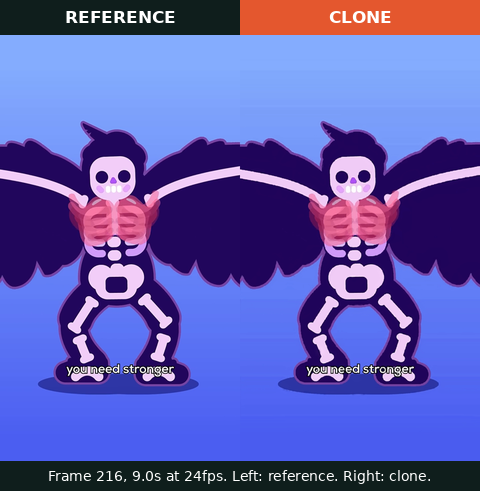
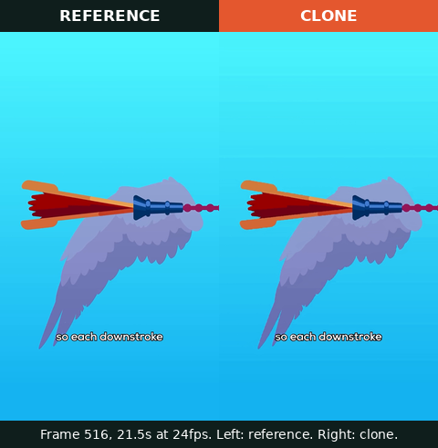
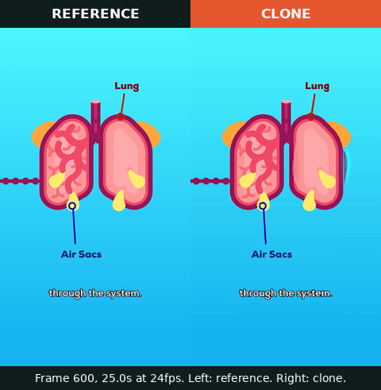
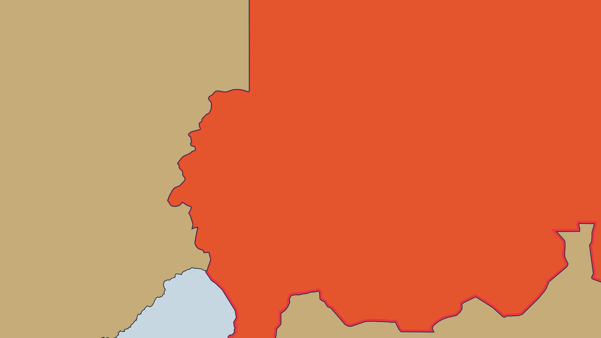
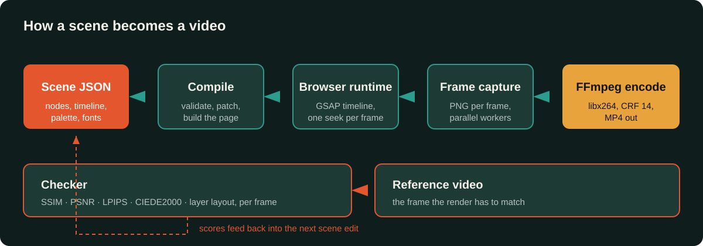

<p align="center">
  
</p>

# Headless Motion


Headless Motion lets an AI agent make motion graphics in code, with no timeline or editor.

- **What it is:** a toolkit. A scene is a JSON file, a render is one command, a check is numbers.
- **Who it is for:** AI agents that do the work, and the human who gives one final look.
- **Why headless:** an agent cannot scrub a timeline or drag keyframes. It can write files and read numbers.
- **How it works:** the agent writes a scene, the engine renders it, and a checker scores every frame against a reference.

## Proof

The first proof is a 1-to-1 clone of the first 30 seconds of a Kurzgesagt Short.

- **Source:** Kurzgesagt "Could Humans Evolve Flight?", first 30 seconds, 720p, 60 fps, vertical.
- **Clone:** 720x1280, 24 fps, 720 frames, 30.0 seconds.
- **Operator:** Muse Spark ran the tools. Cost was $0.
- **Scope:** proven on one style only, flat 2D vector animation. 3D and grain are untested.

<video src="docs/proof/side-by-side-30s.mp4" width="720" controls></video>

Side-by-side video: **Reference on the left, Clone on the right.** 30 seconds, 24 fps.

An independent judge re-checked every number with its own scripts. Its verdict: **PASS WITH GAPS.**

| Gate | Mean SSIM | Mean PSNR | Min SSIM | LPIPS | Frames below 0.90 |
| --- | --- | --- | --- | --- | --- |
| Gate 1, first 10 s, 240 frames | 0.9926 | 36.21 dB | 0.9887 | 0.0134 | 0 |
| Gate 2, full 30 s, 720 frames | 0.9938 | 36.16 dB | 0.9887 | 0.0106 | 0 |

- **Gate 2 extra checks:** 0 frames below 0.85. Flat colour max 1.71 Delta E (bar 3). Text shift max 0.5 px (bar 2).
- **Human gate:** passed November 9, 2026. Watched at full speed and at 0.25x, with no visible mismatch.

### Evidence gallery

Each still shows **Reference on the left, Clone on the right.** Frame numbers are clone frames at 24 fps. Click a thumbnail for full size.

| | | | |
| --- | --- | --- | --- |
| <a href="docs/proof/sbs-f197.png"></a> | <a href="docs/proof/sbs-f216.png"></a> | <a href="docs/proof/sbs-f516.png"></a> | <a href="docs/proof/sbs-f600.png"></a> |
| Morph, frame 197, 8.2 s. Reference left, Clone right. | Downstroke, frame 216, 9.0 s. Reference left, Clone right. | Wing fold, frame 516, 21.5 s. Reference left, Clone right. | Lowest PSNR frame, frame 600, 25.0 s. Reference left, Clone right. |

### Difference maps

Each map shows the absolute difference between Reference and Clone, amplified 8x. Bright pixels mark where the Clone differs. Nearly black means nearly identical.

| | |
| --- | --- |
| <a href="docs/proof/diff-f197-8x.png"></a> | <a href="docs/proof/diff-f600-8x.png"></a> |
| Frame 197, 8.2 s. Clone minus Reference, 8x. | Frame 600, 25.0 s. Clone minus Reference, 8x. |

### Who did what

- **We built the tools:** the renderer, the checker, and the measurement commands.
- **Muse Spark operated them:** it wrote scenes, ran renders, and applied fixes.
- **Richardson gave the final look:** one human gate after the machine PASS.

## What it renders

Both images are real frames from real renders. Neither is a mockup.

| | |
| --- | --- |
|  |  |
| **Real scene: map-sample.** Final profile. The camera is mid-travel, so no labels show yet. | **Test fixture: scene-min.** Final profile. One text line and one orange square. |
| What to learn: the map module draws real Natural Earth geography with its fixed visual system. | What to learn: this is the smallest valid scene. It is the file the setup command renders. |

## How you use it

### Setup

- **Node:** version 20 or newer.
- **ffmpeg:** installed on the path.
- **Chromium:** installed through Playwright.

```bash
npm install
node src/renderer/cli.mjs render tests/fixtures/scene-min.json --profile draft --out out/scene-min
```

That renders the scene-min fixture: 10 seconds, 1920x1080, 24 fps.

| Profile | Size | Supersample | Preset | CRF | Use |
| --- | --- | --- | --- | --- | --- |
| previs | 854x480 | 1 | veryfast | 28 | Fast look, iterate |
| draft | 1920x1080 | 1 | fast | 20 | Check timing and layout |
| final | 1920x1080 | 1.5 | medium | 14 | Deliver |
| final-max | 1920x1080 | 2 | slow | 14 | Best quality |

- `--frames 0:120` renders only part of a scene.
- `--set nodes.title.props.text="Hello"` overrides a scene value without editing the file. You can repeat it.

### Three doors

| Door | Who uses it | What it is |
| --- | --- | --- |
| Chat plus human gate | The human | You talk in chat. The agent does the work. You give one final look after a machine PASS. |
| CLI | Agents with a shell, and scripts | `node src/cli/hme.mjs <command>`, 28 commands. |
| MCP | Agents without a shell | `hme mcp`, 9 tools. |

You do not run commands yourself. The CLI and MCP are machine doors.

**CLI commands (28):** render, validate, export, gates, compare, layering, blur-grain, trace, frame-style, timing, diagnose, colour, contour, ledger, path, type, control, extract, fonts, player-pass, context, mcp, zoom-velocity, vignette, gradient, composition, rig, fix.

**MCP tools (9):** compare, trace, diagnose, control, extract, fonts, player-pass, context, frame-style.

- Render and fix are **not** in MCP today. An agent needs the CLI for those.

### The human gate

The gate opens once, only after a machine PASS. It is the only step that needs a human.

1. The agent sends one verdict line, the side-by-side video, and the worst frames as stills.
2. Watch the video once at full speed, start to end.
3. Watch it again at 0.25x, start to end.
4. Give one of two answers:
   - **Approve:** say "Approve, no mismatch."
   - **Reject:** give a time in seconds, a side (clone or reference), and what is wrong.

- A reject with a time and a side lets the agent fix it without asking you anything.
- A reject with no time gets one question back: "At what time did you see it?"
- Approve does not approve publish, send, pay, delete, or deploy. Those need their own approval.

## Scene format

A scene is one JSON file, schema `hme.scene/1.0`.

- **Nodes:** text, shapes, maps, or charts.
- **Timeline:** moves node properties between keyframes with named easings.
- **Palette and fonts:** named once, used by name in nodes.

```json
{
  "schema": "hme.scene/1.0",
  "meta": { "id": "hello", "fps": 24, "width": 1920, "height": 1080, "duration": 240, "seed": 1337 },
  "fonts": [{ "family": "Montserrat", "weight": 700, "src": "fonts/Montserrat-Bold.ttf" }],
  "palette": { "ground": "#101820", "ink": "#f4f1ea", "accent": { "color": "#e8a33d" } },
  "nodes": [
    { "id": "title", "type": "text", "z": 2,
      "box": { "x": 160, "y": 120, "w": 1600, "h": 160 },
      "props": { "text": "Headless Motion",
        "font": { "family": "Montserrat", "weight": 700, "size": 96 },
        "color": "ink", "align": "left" } },
    { "id": "bar", "type": "shape", "z": 1,
      "box": { "x": 160, "y": 600, "w": 240, "h": 240 },
      "props": { "kind": "rect", "fill": "accent", "radius": 24 } }
  ],
  "timeline": [
    { "node": "bar", "prop": "transform.x",
      "keys": [
        { "f": 0, "v": 0 },
        { "f": 120, "v": 1200, "ease": "easeInOutCubic" },
        { "f": 240, "v": 600, "ease": "easeOutQuint" } ] }
  ]
}
```

- **Full docs:** `prompts/01-scene-format.md`.
- **Agent prompts:** five files in `prompts/` teach the scene format, renderer, map system, chart and text module, and frame checker.
- **Map module (`src/map/`):** two registers, a five colour palette, Montserrat labels, one focus at a time.

## How it works




The loop has four steps. The agent repeats them until every number passes.

## Tools

Each tool is a file or command an agent calls. Status is what the last independent check said.

### Core tools

| Tool | File | What it does | Status |
| --- | --- | --- | --- |
| Reference teardown | `src/reference/teardown.py` | Measures a reference into a profile: palette, geometry, shots, cuts, trajectories, traces | Pass, judge confirmed |
| Easing picker | `src/scene/pick-ease.mjs` | Ranks easings and springs by measured error against a reference trajectory | Pass, judge confirmed |
| Defect taxonomy | `src/checker/defects.json`, `src/checker/defects.py` | Maps each failure code to a cause and a fix, and logs it | Pass, judge confirmed |
| Banned list | `banned.json` | Patterns that must never ship again, linted before rendering | Pass, judge confirmed |
| Frame checker | `src/checker/` | Scores every frame: SSIM, PSNR, LPIPS, flat colour, motion, text shift, layout | In use, Gate 3 LPIPS still being measured |
| Renderer | `src/renderer/` | Headless Chromium capture plus ffmpeg encode, 1920x1080 at 24 fps | In use |
| Map module | `src/map/` | Draws real Natural Earth geography | In use |
| Chart and text module | `src/scene/` | Bars, lines, and kinetic type | In use |
| CLI | `src/cli/hme.mjs` | One command surface for render, check, compare, and player pass | In use |
| Player pass | `run-player-pass.py` | Screenshots our video the same way as the reference, so the check compares like with like | In use |

### Measurement tools

Every measurement returns the same shape: a verdict, the numbers, a correction in scene terms, the next command, and its limits.

| Tool | Command | What it measures | Status |
| --- | --- | --- | --- |
| Compare | `hme compare` | SSIM, PSNR, LPIPS, flat colour | In use |
| Diagnose | `hme diagnose` | Names the error and the fix from a frame pair | In use |
| Trace | `hme trace` | Palette, labels, trajectories, cuts | In use |
| Frame style | `hme frame-style` | Pace per frame plus a plain-language style prompt | Built, test passing |
| Control | `hme control` | The ceiling a perfect clone can reach | In use |
| Extract | `hme extract` | Cuts a pixel region out of a reference frame | In use |
| Fonts | `hme fonts` | Ranks free fonts by glyph shape against a reference label | In use |
| Zoom velocity | `hme zoom-velocity` | Zoom speed per second, and where the curve bends | Done, judge confirmed |
| Contour | `hme contour` | Outline difference, Hausdorff and Chamfer distance | Done, judge confirmed |
| Blur and grain | `hme blur-grain` | Blur and grain ratios, reference vs ours | Built, judge not yet run |
| Vignette | `hme vignette` | Corner darkness, matched mean ratio | Done, judge confirmed |
| Colour and halo | `hme colour` | Colour histograms and halo falloff | Done, judge confirmed |
| Layering | `hme layering` | Z-order and pixel counts per layer | Done, judge confirmed |
| Type | `hme type` | Font match, glyph shape, spacing, weight | Judge confirmed |
| Timing | `hme timing` | Timing offset per object, median and warp table | Built, judge not yet done |

Two facts to know before trusting a number:

- **Ceiling:** a perfect clone scores about 0.96 SSIM, not 1.00. YouTube compression alone costs 0.03 to 0.07.
- **Timing drifts:** on the Seg4 map, the badge runs 0.46 to 1.08 s early, median 0.71. One global delay leaves about 20 px of error. The warp table leaves about 2 px.

### Authoring tools

These close gaps found in the Kurzgesagt "Alcohol is AMAZING" first 5 seconds. Status is from November 9, 2026.

| Tool | What it adds | Status |
| --- | --- | --- |
| Character rig | Named joints, so eyes, brows, and arms move by keyframe | 70%, proof render done |
| Illustration tracing | Reference art to vector paths, with VTracer, Potrace, and pixel cutout fallbacks | 20%, monster traces at SSIM 0.90, skulls pass as pixel cutout at 0.99 |
| Gradients and glow | Gradient fills, glow, and soft edges | 50%, proof passes within the colour bar |
| Particle system | Seeded particles that render byte-identical | Built, final verification pending |
| Automated fixing | Applies a report's correction to a new scene version, never in place | 60%, five fixer functions done |

- The rig proves the mechanism with simple shapes. A faithful character still needs traced hair, face shading, and clothing.

### Frame 184 study

- **Motion is close, not exact:** the descent measured 50.3 px against 57.3 px expected, a 7 px gap. The hold measured 95.2 px, exact.
- **Colour is exact:** code models reproduced all 5 measured RGB stops.
- **Drawing is the bottleneck:** the figure measured 0.570 of frame width against a 0.60 target.
- **Model widths vs 0.60:** Flare 0.548, Sunburst 0.533, Fable 0.39, Terra 0.22, Headless Motion 0.570.
- **Cost:** about $1.64 across 8 model generations.
- **Files:** `study/frame184-comparison/`.

## Verification

The checker (`src/checker/`) reports four scores plus a layer layout check.

- **SSIM:** how close the picture matches, 0 to 1. 1.00 is identical.
- **PSNR:** how clean the picture is, in dB. Higher is cleaner.
- **LPIPS:** how different it looks to a trained model. 0 is identical.
- **Flat colour:** colour difference in Delta E. Under 3, the eye cannot tell them apart.

A clone passes only if it meets every number in its segment's bar. The bar is frozen as pred-v1, so it cannot move.

| Segment | SSIM | PSNR | LPIPS | Flat colour |
| --- | --- | --- | --- | --- |
| Kurzgesagt 1 and 2 | 0.98 | 38 dB | 0.05 | under 3 Delta E |
| TED-Ed glue vs tape | 0.95 | 35 dB | 0.08 | under 3 Delta E |
| Search Party map | 0.96 | 35 dB | 0.08 | under 3 Delta E |

- **Example fail:** the TED-Ed baseline scored SSIM 0.686 against its 0.95 bar.
- **Determinism:** two runs of the same profile give a byte-identical video.
- **Measured scores:** [BENCHMARKS.md](BENCHMARKS.md).

## Speed

Measured November 7, 2026: 4 core Linux VM, no GPU, 10 second clip, 1920x1080, 24 fps.

| Profile | Before fast render | After fast render |
| --- | --- | --- |
| draft | 76 to 88 s | 25 to 35 s |
| final | 140 to 243 s | 37 to 57 s |

- **Bottleneck is capture:** in one draft run, ffmpeg took 52 s and Chromium screenshots took 640 s.
- **Fast render path:** a map layer cache, frame dedup, and a real-time preview mode.
- **Map final:** 242.6 s down to 57.0 s, a 4.3x gain, byte-identical across three runs.
- **Quality held:** old vs new renders score SSIM 0.99999.
- **Logs:** `benchmark/results-2026-11-07.json` and `speed-log.md`.

## Project structure

```
src/
  scene/      scene format, profiles, lint, chart and text, easing picker
  renderer/   headless Chromium capture, ffmpeg encode, CLI
  map/        geography, projection, map visual system
  checker/    SSIM, PSNR, LPIPS, colour, layer layout, defect taxonomy
  reference/  reference teardown: profile, traces, trajectories
  cli/        hme command surface: measurement tools, authoring tools, MCP
  rig/        character rig schema and expander
  fix/        automated fixing: timing, position, text, refuse, gate
banned.json   patterns that must never ship again, linted before rendering
speed-log.md  per-step timing log
tests/        fixtures and unit tests (76 unit, 13 browser)
prompts/      the five prompt files an agent uses to drive the engine
benchmark/    timing runs and before/after results
verify-seg4/  the Search Party map clone: trace, numbers, reports
```

## Status

Research preview. True today:

- The engine renders deterministically at 1920x1080.
- The checker runs LPIPS on every frame.
- The layer layout check takes 31 seconds for four paired stills.
- The fast render path is built: map final 242.6 s to 57.0 s.
- Fifteen measurement commands run under one `hme` CLI.
- Five authoring tools are in progress: rig, tracing, gradients and glow, particles, and fixing.
- Untested: original work with no reference. The gate does not open for it yet.

**Roadmap:** finish the five authoring tools. Then the Seg4 v5 true clone. Then ten new sequences. Then a native Skia renderer with no browser.

Full method and history: [benchmark/README.md](benchmark/README.md).

## Development

The stored GitHub credential only works for `api.github.com`. Pushes go through the git database API:

```bash
~/workspace/custom-connectors/custom.legacy-github/bin/gh_push.py \
  --repo richardsondx/headless-motion --branch main --message "msg" \
  $(git ls-files | awk '{print $1"="$1}')
```

## Author

Created by Richardson Dackam, Toronto, 2026.

## License

MIT. See `LICENSE`.
