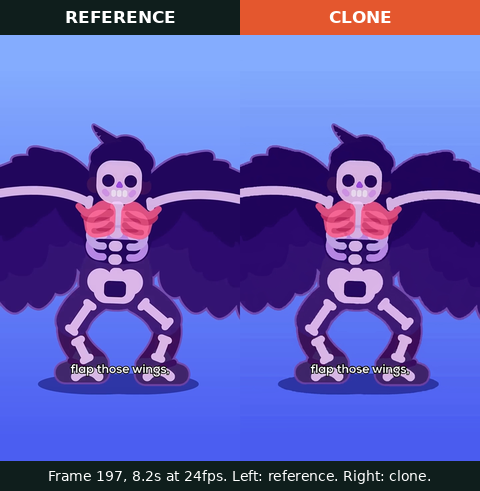

<p align="center">
  
</p>

# Headless Motion


Headless Motion lets an AI agent make motion graphics in code, with no timeline or editor.

- **What it is:** a toolkit. A scene is a JSON file, a render is one command, a check is numbers.
- **Who it is for:** AI agents that do the work, and the human who gives one final look.
- **Why headless:** an agent cannot scrub a timeline or drag keyframes. It can write files and read numbers.
- **How it works:** the agent writes a scene, the engine renders it, and a checker scores every frame.

## How you use it

You work with an AI agent. You never run commands. The agent runs them.

1. Clone this repo.
2. Run `npm install`.
3. Paste the setup prompt below into your agent.
4. Watch the render it shows you.

That first render is a real MP4 file made from a real scene file, `tests/fixtures/scene-min.json`.

After that, you describe videos in plain words. The agent writes, renders, checks, and fixes. You give one final look at the end.

### What the agent needs

- **Node:** version 20 or newer.
- **ffmpeg:** installed on the path.
- **Chromium:** installed through Playwright.

The setup prompt tells the agent to check these and install anything missing.

## Use it with your agent

Paste these into Claude Code, Codex, Muse, Grok, or any OpenAI Codex-style agent.

### Prompt 1: setup

```text
Set up Headless Motion on this machine and render a test video.

1. If the repo is not cloned yet, clone richardsondx/headless-motion and open its root folder.
2. Read these five files before doing anything else:
   - prompts/01-scene-format.md
   - prompts/02-renderer-adapter.md
   - prompts/03-map-module.md
   - prompts/04-chart-text.md
   - prompts/05-frame-checker.md
3. Run: npm install
4. Check that Node is version 20 or newer.
5. Check that ffmpeg is installed and on the path.
6. Check that Chromium is installed through Playwright.
7. If anything is missing, install it the right way for this machine. Tell me what you installed.
8. Render the scene-min fixture:
   node src/renderer/cli.mjs render tests/fixtures/scene-min.json --profile draft --out out/scene-min
9. Show me the MP4 file and tell me where it is saved.
```

### Prompt 2: make a video

```text
Make me a video with Headless Motion. Here is what I want:

[Describe the video in plain words: what appears, what moves, colours, text, length.]

Work like this:
1. Write the scene JSON using prompts/01-scene-format.md. Use schema hme.scene/1.0.
2. Validate the scene with src/scene/validate.mjs, as prompts/01-scene-format.md explains.
3. Render it:
   node src/cli/hme.mjs render <scene.json> --profile draft --render-out <dir>
4. Check the render. Read the JSON report: verdict, numbers, corrections, next command, limits.
5. Fix the worst gap first. Save a new scene version. Never edit in place.
6. Repeat render, check, and fix until the numbers pass, or name the gap you cannot close.
7. Render the final version with --profile final.
8. Then ask me for one final look. Send one verdict line, the video, and the worst frames as stills.
I will answer "Approve, no mismatch." or give a time, a side, and what is wrong.
```

### Prompt 3: copy a reference

```text
Copy this reference video with Headless Motion: [path to reference.mp4]

Work like this:
1. Measure the reference into a style profile:
   node tools/map-frames.mjs <reference.mp4> --start-s <n> --end-s <n> --out <dir>
2. Get pace numbers and a plain-language style prompt:
   node tools/frame-style.mjs <reference.mp4> --start-s <n> --end-s <n> --out <prompt.md>
3. Write the scene JSON using prompts/01-scene-format.md and the profile from step 1.
4. Render it:
   node src/cli/hme.mjs render <scene.json> --profile draft --render-out <dir>
5. Check the render against the reference, frame by frame, as prompts/05-frame-checker.md explains:
   python -I -m checker run --segment <cfg> --render <render.mp4> --ref <reference.mp4> --out out/<seg>/check
6. Use node src/cli/hme.mjs compare and node src/cli/hme.mjs diagnose to find the worst gap.
7. Fix the worst gap first. Save a new scene version. Repeat steps 4 to 7.
8. Stop when every number passes: mean SSIM 0.95 or more, mean PSNR 35 dB or more,
   LPIPS 0.08 or less, flat colour under 3 Delta E. If a gap will not close, name it.
9. Then ask me for one final look. Send one verdict line, the side-by-side video, and the worst frames as stills.
```

## Three doors

| Door | Who uses it | What it is |
| --- | --- | --- |
| Chat plus final look | The human | You talk in chat. The agent does the work. You give one final look after a machine PASS. |
| CLI | Agents with a shell, and scripts | `node src/cli/hme.mjs <command>`, 28 commands. |
| MCP | Agents without a shell | `node src/cli/hme.mjs mcp`, 9 tools. |

You do not run commands yourself. The CLI and MCP are machine doors.

- **CLI:** every measurement returns one JSON report. Exit 0 is pass, 1 is fail, 2 is usage error.
- **MCP:** run it from the repo root. It speaks JSON-RPC 2.0 over stdio, one request per line.
- **MCP limit:** render and fix are not in MCP. An agent needs the CLI for those.

**MCP tools (9):** compare, trace, diagnose, control, extract, fonts, player-pass, context, frame-style.

**CLI commands (28):** render, validate, export, gates, compare, layering, blur-grain, trace, frame-style, timing, diagnose, colour, contour, ledger, path, type, control, extract, fonts, player-pass, context, mcp, zoom-velocity, vignette, gradient, composition, rig, fix.

## The final look

The final look happens once, after a machine PASS. It is the only step that needs a human.

1. The agent sends one verdict line, the side-by-side video, and the worst frames as stills.
2. Watch the video once at full speed, start to end.
3. Watch it again at 0.25x, start to end.
4. Give one of two answers:
   - **Approve:** say "Approve, no mismatch."
   - **Reject:** give a time in seconds, a side (clone or reference), and what is wrong.

- A reject with a time and a side lets the agent fix it without asking you anything.
- A reject with no time gets one question back: "At what time did you see it?"
- Approve does not approve publish, send, pay, delete, or deploy. Those need their own approval.

## Proof

**Proven:** an agent cloned the first 30 seconds of a short video, frame for frame.

- **Source:** Kurzgesagt "Could Humans Evolve Flight?", first 30 seconds, 720p, 60 fps, vertical.
- **Clone:** 720x1280, 24 fps, 720 frames, 30.0 seconds.
- **Style:** flat 2D vector animation only. 3D and grain are untested.
- **Operator:** Muse Spark ran the tools. Cost was $0.

| Run | Mean SSIM | Mean PSNR | Min SSIM | LPIPS | Frames below 0.90 |
| --- | --- | --- | --- | --- | --- |
| First 10 seconds, 240 frames | 0.9926 | 36.21 dB | 0.9887 | 0.0134 | 0 |
| Full 30 seconds, 720 frames | 0.9938 | 36.16 dB | 0.9887 | 0.0106 | 0 |

- **Full 30 seconds extras:** 0 frames below 0.85. Flat colour max 1.71 Delta E. Text shift max 0.5 px.
- **Independent judge:** re-checked every number with its own scripts. Verdict: PASS WITH GAPS.
- **Final look:** passed November 9, 2026, at full speed and at 0.25x. No visible mismatch.
- **What it means for you:** on flat 2D vector work, an agent can match a reference closely.
- **Full numbers:** [BENCHMARKS.md](BENCHMARKS.md).

### Evidence gallery

Each still shows **Reference on the left, Clone on the right.** Frame numbers are clone frames at 24 fps.

| | | | |
| --- | --- | --- | --- |
| <a href="docs/proof/sbs-f197.png"></a> | <a href="docs/proof/sbs-f216.png"></a> | <a href="docs/proof/sbs-f516.png"></a> | <a href="docs/proof/sbs-f600.png"></a> |
| Morph, frame 197, 8.2 s. | Downstroke, frame 216, 9.0 s. | Wing fold, frame 516, 21.5 s. | Lowest PSNR frame, frame 600, 25.0 s. |

## The pass bar

The checker (`src/checker/`) reports four scores plus a layer layout check.

- **SSIM:** how close the picture matches, 0 to 1. 1.00 is identical.
- **PSNR:** how clean the picture is, in dB. Higher is cleaner.
- **LPIPS:** how different it looks to a trained model. 0 is identical.
- **Flat colour:** colour difference in Delta E. Under 3, the eye cannot tell them apart.

A render passes only if it meets all of these numbers:

- Mean SSIM 0.95 or more.
- Mean PSNR 35 dB or more.
- LPIPS 0.08 or less.
- Flat colour under 3 Delta E.

The bar is frozen, so it cannot move. Two runs of the same profile give a byte-identical video.

Full numbers: [BENCHMARKS.md](BENCHMARKS.md).

## Scene format

A scene is one JSON file, schema `hme.scene/1.0`.

- **Nodes:** text, shapes, maps, or charts.
- **Timeline:** moves node properties between keyframes with named easings.
- **Palette and fonts:** named once, used by name in nodes.

```json
{
  "schema": "hme.scene/1.0",
  "meta": { "id": "hello", "fps": 24, "width": 1920, "height": 1080, "duration": 240, "seed": 1337 },
  "fonts": [{ "family": "Montserrat", "weight": 700, "src": "fonts/Montserrat-Bold.ttf" }],
  "palette": { "ground": "#101820", "ink": "#f4f1ea", "accent": { "color": "#e8a33d" } },
  "nodes": [
    { "id": "title", "type": "text", "z": 2,
      "box": { "x": 160, "y": 120, "w": 1600, "h": 160 },
      "props": { "text": "Headless Motion",
        "font": { "family": "Montserrat", "weight": 700, "size": 96 },
        "color": "ink", "align": "left" } },
    { "id": "bar", "type": "shape", "z": 1,
      "box": { "x": 160, "y": 600, "w": 240, "h": 240 },
      "props": { "kind": "rect", "fill": "accent", "radius": 24 } }
  ],
  "timeline": [
    { "node": "bar", "prop": "transform.x",
      "keys": [
        { "f": 0, "v": 0 },
        { "f": 120, "v": 1200, "ease": "easeInOutCubic" },
        { "f": 240, "v": 600, "ease": "easeOutQuint" } ] }
  ]
}
```

- **Full docs:** `prompts/01-scene-format.md`.
- **Agent prompts:** five files in `prompts/` teach the scene format, renderer, map system, chart and text module, and frame checker.
- **Map module (`src/map/`):** real Natural Earth geography, a five colour palette, Montserrat labels, one focus at a time.

### Render profiles

| Profile | Size | Supersample | Preset | CRF | Use |
| --- | --- | --- | --- | --- | --- |
| previs | 854x480 | 1 | veryfast | 28 | Fast look, iterate |
| draft | 1920x1080 | 1 | fast | 20 | Check timing and layout |
| final | 1920x1080 | 1.5 | medium | 14 | Deliver |
| final-max | 1920x1080 | 2 | slow | 14 | Best quality |

- `--frames 0:120` renders only part of a scene.
- `--set nodes.title.props.text="Hello"` overrides a scene value without editing the file. You can repeat it.

## How it works


The loop has four steps. The agent repeats them until every number passes.

## Tools

Each tool is a file or command an agent calls. Status is what the last independent check said.

### Core tools

| Tool | File | What it does | Status |
| --- | --- | --- | --- |
| Reference teardown | `src/reference/teardown.py` | Measures a reference into a profile: palette, geometry, shots, cuts, trajectories, traces | Pass, judge confirmed |
| Easing picker | `src/scene/pick-ease.mjs` | Ranks easings and springs by measured error against a reference trajectory | Pass, judge confirmed |
| Defect taxonomy | `src/checker/defects.json`, `src/checker/defects.py` | Maps each failure code to a cause and a fix, and logs it | Pass, judge confirmed |
| Banned list | `banned.json` | Patterns that must never ship again, linted before rendering | Pass, judge confirmed |
| Frame checker | `src/checker/` | Scores every frame: SSIM, PSNR, LPIPS, flat colour, motion, text shift, layout | In use |
| Renderer | `src/renderer/` | Headless Chromium capture plus ffmpeg encode, 1920x1080 at 24 fps | In use |
| Map module | `src/map/` | Draws real Natural Earth geography | In use |
| Chart and text module | `src/scene/` | Bars, lines, and kinetic type | In use |
| CLI | `src/cli/hme.mjs` | One command surface for render, check, compare, and player pass | In use |
| Player pass | `run-player-pass.py` | Screenshots our video the same way as the reference, so the check compares like with like | In use |

### Measurement tools

Every measurement returns the same shape: a verdict, the numbers, a correction in scene terms, the next command, and its limits.

| Tool | Command | What it measures | Status |
| --- | --- | --- | --- |
| Compare | `hme compare` | SSIM, PSNR, LPIPS, flat colour | In use |
| Diagnose | `hme diagnose` | Names the error and the fix from a frame pair | In use |
| Trace | `hme trace` | Palette, labels, trajectories, cuts | In use |
| Frame style | `hme frame-style` | Pace per frame plus a plain-language style prompt | Built, test passing |
| Control | `hme control` | The ceiling a perfect clone can reach | In use |
| Extract | `hme extract` | Cuts a pixel region out of a reference frame | In use |
| Fonts | `hme fonts` | Ranks free fonts by glyph shape against a reference label | In use |
| Zoom velocity | `hme zoom-velocity` | Zoom speed per second, and where the curve bends | Done, judge confirmed |
| Contour | `hme contour` | Outline difference, Hausdorff and Chamfer distance | Done, judge confirmed |
| Blur and grain | `hme blur-grain` | Blur and grain ratios, reference vs ours | Built, judge not yet run |
| Vignette | `hme vignette` | Corner darkness, matched mean ratio | Done, judge confirmed |
| Colour and halo | `hme colour` | Colour histograms and halo falloff | Done, judge confirmed |
| Layering | `hme layering` | Z-order and pixel counts per layer | Done, judge confirmed |
| Type | `hme type` | Font match, glyph shape, spacing, weight | Judge confirmed |
| Timing | `hme timing` | Timing offset per object, median and warp table | Built, judge not yet done |

Two facts to know before trusting a number:

- **Ceiling:** a perfect clone scores about 0.96 SSIM, not 1.00. YouTube compression alone costs 0.03 to 0.07.
- **Timing drifts:** one global delay can leave about 20 px of error. The warp table leaves about 2 px.

### Authoring tools

Status is from November 9, 2026.

| Tool | What it adds | Status |
| --- | --- | --- |
| Character rig | Named joints, so eyes, brows, and arms move by keyframe | 70%, proof render done |
| Illustration tracing | Reference art to vector paths, with VTracer, Potrace, and pixel cutout fallbacks | 20% |
| Gradients and glow | Gradient fills, glow, and soft edges | 50%, proof passes within the colour bar |
| Particle system | Seeded particles that render byte-identical | Built, final verification pending |
| Automated fixing | Applies a report's correction to a new scene version, never in place | 60%, five fixer functions done |

## Speed

Measured November 7, 2026: 4 core Linux VM, no GPU, 10 second clip, 1920x1080, 24 fps.

| Profile | Before fast render | After fast render |
| --- | --- | --- |
| draft | 76 to 88 s | 25 to 35 s |
| final | 140 to 243 s | 37 to 57 s |

- **Bottleneck is capture:** Chromium screenshots take far longer than the ffmpeg encode.
- **Map final:** 242.6 s down to 57.0 s, byte-identical across three runs.
- **Quality held:** old vs new renders score SSIM 0.99999.
- **Logs:** `benchmark/results-2026-11-07.json` and `speed-log.md`.

## Project structure

```
src/
  scene/      scene format, profiles, lint, chart and text, easing picker
  renderer/   headless Chromium capture, ffmpeg encode, CLI
  map/        geography, projection, map visual system
  checker/    SSIM, PSNR, LPIPS, colour, layer layout, defect taxonomy
  reference/  reference teardown: profile, traces, trajectories
  cli/        hme command surface: measurement tools, authoring tools, MCP
  rig/        character rig schema and expander
  fix/        automated fixing: timing, position, text, refuse
tools/        map-frames.mjs and frame-style.mjs, reference measurement
banned.json   patterns that must never ship again, linted before rendering
speed-log.md  per-step timing log
tests/        fixtures and unit tests (76 unit, 13 browser)
prompts/      the five prompt files an agent uses to drive the engine
benchmark/    timing runs and before/after results
```

## Status

Research preview. True today:

- The engine renders deterministically at 1920x1080.
- The checker runs LPIPS on every frame.
- The fast render path is built: map final 242.6 s to 57.0 s.
- Fifteen measurement commands run under one `hme` CLI.
- Five authoring tools are in progress: rig, tracing, gradients and glow, particles, and fixing.
- Untested: original work with no reference.

**Roadmap:** finish the five authoring tools. Then the Seg4 v5 true clone. Then ten new sequences. Then a native Skia renderer with no browser.

Full method and history: [benchmark/README.md](benchmark/README.md).

## Author

Created by Richardson Dackam, Toronto, 2026.

## License

MIT. See `LICENSE`.
